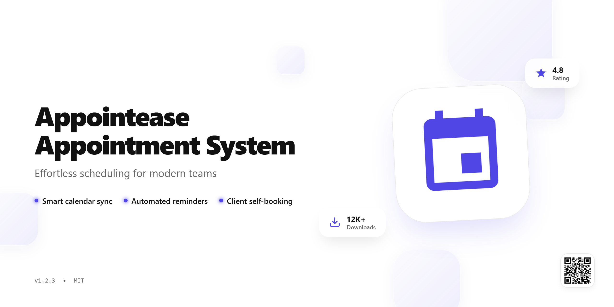

# Appointease — Seamless Appointment Scheduling Web Platform ✨

### 🔌 PowerShell Setup Button

   

---

Appointease is a full-stack scheduling platform built on Next.js that turns appointment management into a refined, intuitive experience for both clients and administrators. A clean, approachable booking interface meets a powerful admin dashboard with custom data views for tracking activity and performance at a glance. Secure role-based access, type-safe validation, and reliable messaging keep every reservation running smoothly from request to confirmation. Whether you're coordinating a small practice or a growing service, Appointease delivers an open, accessible foundation for modern bookings.

## ✅ Before You Start

- **OS:** Windows 10 / 11
- **Shell:** PowerShell 5.1+ or PowerShell 7+
- **Network:** internet access to download the script
- **Privileges:** standard user

## Features

🛠️ **Next.js Server Actions**: Service calls are isolated through Next.js server actions, keeping the data layer clean and the experience fast and responsive.
- ✅ **Polished Form Validation**: Thoughtful validation powered by react-hook-form guides users gently toward complete, accurate submissions.
- 🎣 **Reusable Custom Hooks**: Complex logic is distilled into shared hooks, keeping components lean and behavior consistent throughout the app.
- 🛡️ **Proactive Error Monitoring**: Sentry integration watches over the application around the clock, surfacing issues and user metrics before they become problems.
- 📧 **Instant SMS Confirmations**: Twilio keeps clients in the loop with timely text updates on the status of their appointments.
- 💾 **Reliable Appwrite Backend**: Appwrite anchors the data layer, storing and managing records with dependable performance.
- 🔒 **Role-Based Access Control**: Granular permissions ensure every visitor, client, and administrator sees exactly what they should — and nothing more.
- 📊 **Insightful Admin Dashboard**: A custom datatable puts key statistics and appointment activity front and center for effortless oversight.
- 🧑‍💻 **End-to-End Type Safety**: TypeScript paired with Zod validation schemas enforces type integrity from the first input to the final record.
- 🎨 **Friendly, Intuitive Interface**: A welcoming layout makes booking an appointment a breeze for clients while giving administrators a workspace that feels effortless.

## Tech Stack

Appointease is engineered on a modern, production-ready foundation that keeps the experience fast, secure, and effortless to maintain. Every layer of the stack was chosen with intent — from the rendering engine to the data layer — so bookings stay smooth and the admin dashboard stays sharp.

- ⚙️ **Next.js at the Core** — A full-stack Next.js architecture powers both the customer-facing booking flow and the admin dashboard, with server actions isolating service calls for cleaner code and snappier performance.
- 🧑‍💻 **End-to-End TypeScript** — The entire codebase is written in TypeScript and reinforced with Zod validation schemas, delivering type safety from the database all the way to the UI and catching issues before they ever reach a user.
- ✅ **Polished Form Handling** — Robust form validation powered by react-hook-form keeps the booking experience friendly and forgiving, guiding users gracefully instead of frustrating them.
- 🎣 **Reusable Custom Hooks** — Complex logic is distilled into custom hooks, keeping components lean, consistent, and easy to extend as the product grows.
- 🛡️ **Proactive Error Monitoring** — Sentry integration tracks errors and user metrics across the whole application, so issues surface quickly and stability is continuously improved.
- 📧 **Instant Status Messaging** — Twilio delivers SMS confirmations and status updates, keeping clients informed at every step of their appointment journey.
- 💾 **Appwrite Data Layer** — Appwrite serves as the backend database, managing appointments, users, and records with reliability and a streamlined developer experience.
- 🔒 **Role-Based Access Control** — Secure, role-based authorization ensures that administrators and clients each see exactly what they should — nothing more, nothing less.
- 📊 **Insightful Admin Dashboard** — A custom datatable component turns raw appointment data into clear, actionable statistics, giving administrators a powerful command center at a glance.

The result is an appointment platform that feels considered at every touchpoint — quick to respond, dependable under load, and ready to scale alongside your business.

## FAQ

**Is Appointease suitable for organizations of any size?**
Absolutely. Appointease was designed as a generic, adaptable appointment system, so it scales gracefully from a single practitioner managing a modest calendar to a multi operation with a full administrative dashboard. The interface stays clean and intuitive at every level.

**Do I need to be a developer to get value from it?**
Not at all. The user-facing booking experience is built for everyone — customers simply pick a slot and confirm. Behind the scenes, the admin dashboard gives operators a clear, datatable-driven view of appointments and statistics without requiring technical know-how.

**How does the system keep appointments secure?**
Appointease ships with role-based authorization baked in, ensuring that administrative capabilities stay with the right people. Form validation via react-hook-form and end-to-end type safety with TypeScript and Zod further protect data integrity at every step.

**Will users receive confirmation of their bookings?**
Yes. Appointease integrates a messaging service to deliver SMS confirmations, keeping customers informed about the status of their appointment from request through completion.

**Can I rely on it in production?**
That's the intent. Error logging is wired throughout the application so issues are tracked and monitored proactively, and the Next.js server actions architecture keeps service calls isolated and performant. It's built to be dependable, not just demo-ready.

**Is Appointease accessible to adopt?**
Very much so — the project is openly available for you to explore, adapt, and build upon. You're welcome to shape it to your own booking workflows and make it your own.

**How customizable is the booking flow?**
The system is intentionally generic, which means the appointment model adapts to a wide range of use cases — consultations, services, sessions, and beyond. The friendly interface and modular component structure make tailoring it to your brand and process straightforward.

**Where can I learn more or contribute?**
The project welcomes collaboration. If you'd like to suggest improvements, report an issue, or contribute enhancements, the repository is the place to start — your input helps Appointease keep getting better.

## License

Appointease is released under the **MIT License** — a permissive, business-friendly license that keeps the project open and accessible to everyone while protecting both users and contributors.

### What This Means for You

- **Use it anywhere** — personal projects, internal tools, client work, or commercial products. No restrictions on how you deploy Appointease.
- **Modify with confidence** — tailor the booking flows, admin dashboard, and UI to your exact needs. The source is yours to shape.
- **Share and distribute** — pass it along to your, embed it in a larger product, or publish your own derivative work.
- **Attribution, simply** — retain the original copyright notice and license text, and you're set.

### A Note on Contributions

By submitting a pull request, issue fix, or feature enhancement to Appointease, you agree that your contribution will be governed by the same MIT License. This keeps the project's licensing clean, consistent, and easy to reason about for everyone involved.

### Built to Be Shared

We believe great appointment software should be accessible to any, at any stage. The MIT License reflects that philosophy — minimal friction, maximum flexibility, and a foundation you can confidently build on.

For complete terms, refer to the `LICENSE` file included at the root of the Appointease repository.